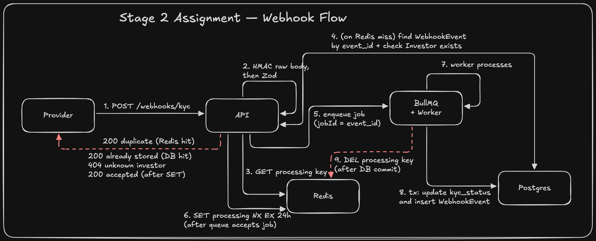

# KYC Webhook Integration Service

Express service that accepts signed KYC webhooks, updates investor status asynchronously, and serves a tenant-scoped status read.

## Rough System Design

Rough system design sketched by me before implementation to give the AI clear context on the expected webhook, idempotency, and worker flow:



## Requirements

- Node.js 20+
- Docker

## Run

```bash
docker compose up -d
npm run dev
```

`npm run dev` installs dependencies when `node_modules` is missing, copies `.env.example` to `.env` when needed, applies Prisma migrations, seeds two tenants, and starts the API and worker in one process. Compose publishes Postgres on host port 5433 and Redis on host port 6380.

The seed prints Investor A's id and a one-hour JWT. Investor A and Investor B are in different tenants.

| | Id |
| --- | --- |
| Investor A | `22222222-2222-4222-8222-222222222222` |
| Investor B | `44444444-4444-4444-8444-444444444444` |

Mint another token from a second terminal:

```bash
npm run token -- 22222222-2222-4222-8222-222222222222
```

## Webhook

`POST /webhooks/kyc`

The `X-KYC-Signature` header is the hex HMAC-SHA256 of the raw body, using `KYC_WEBHOOK_SECRET`. The signature is checked before the body is parsed. `new_status` is `pending`, `approved`, or `rejected`. An unknown `investor_id` returns 404 and is not queued.

```bash
BODY='{"event_id":"evt-1","investor_id":"22222222-2222-4222-8222-222222222222","new_status":"approved","timestamp":"2026-06-20T14:30:00Z"}'
SIG=$(node -e 'const c=require("crypto"); process.stdout.write(c.createHmac("sha256", process.env.KYC_WEBHOOK_SECRET || "dev-webhook-secret").update(process.argv[1]).digest("hex"))' "$BODY")
curl -s -X POST http://localhost:3000/webhooks/kyc \
  -H "Content-Type: application/json" \
  -H "X-KYC-Signature: $SIG" \
  -d "$BODY"
```

The handler returns 200 after the job is queued. The worker then updates `kyc_status`. A repeated `event_id` returns 200 and is not applied again. An invalid signature is 401. A payload missing required fields is 400.

## KYC status

`GET /investors/:id/kyc-status` requires `Authorization: Bearer <jwt>`. The JWT is HS256, signed with `JWT_SECRET`, and must include `tenant_id` and `investor_id`. The token's investor and tenant must match the investor row.

```bash
curl -s http://localhost:3000/investors/22222222-2222-4222-8222-222222222222/kyc-status \
  -H "Authorization: Bearer $TOKEN"
```

Responses are 200, 401, 403, 404, or 500. A matching token for another tenant's investor is 403.

## Environment

`DATABASE_URL`, `REDIS_URL`, `KYC_WEBHOOK_SECRET`, `JWT_SECRET`, and optional `PORT` (default 3000). See `.env.example`.

## Tests

With Postgres and Redis running:

```bash
npm test
```

Step-by-step requests for the webhook and the status read are in [docs/RUN_AND_TEST.md](docs/RUN_AND_TEST.md).

## Write-ups

- [docs/ARCHITECTURE.md](docs/ARCHITECTURE.md)
- [docs/AI_USAGE.md](docs/AI_USAGE.md)
